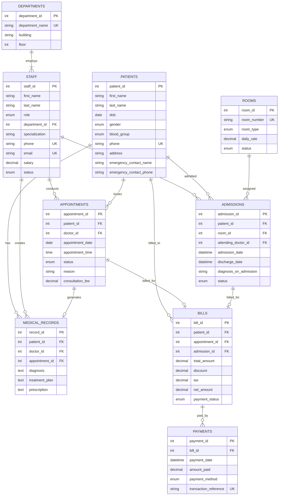

# Hospital Management System (HMS)
### Relational Database Management System Project (MySQL)

A comprehensive, production-ready relational database management system designed to streamline hospital operations, patient records, clinical scheduling, ward occupancy, and financial billing.

---

## 📌 Project Overview

- **RDBMS**: MySQL 8.0+ (with SQLite fallback for instant zero-dependency local testing)
- **Core Modules**:
  1. **Staff & Departments Management**: Department directories, doctors, nurses, receptionists, and roles.
  2. **Patient Electronic Health Records (EHR)**: Patient profiles, medical history, diagnoses, and prescriptions.
  3. **Appointment Scheduling**: Outpatient scheduling, time slots, doctor queues, and status tracking.
  4. **Ward & Bed Occupancy (Admissions)**: Inpatient admissions, room allocation, and discharge workflows.
  5. **Billing & Financial Transactions**: Invoices, tax/discount computations, and multi-channel payment reconciliation (Cash, Cards, UPI, Insurance).

---

## 🗂️ Project File Structure

```text
Project-2/
├── index.html                  # Standalone interactive website frontend (Open directly in browser)
├── database/
│   ├── schema.sql              # MySQL DDL script (tables, constraints, views, triggers, indexes)
│   ├── sample_data.sql         # Seed data script for testing hospital workflows
│   ├── queries.sql             # 8 analytical & operational reporting queries
│   └── hospital_complete.sql   # All-in-one SQL script for 1-click import into MySQL Workbench / phpMyAdmin
├── app.py                      # Interactive Command-Line Interface (CLI)
├── web_app.py                  # Full-featured local web dashboard (Python standard library)
├── db_manager.py               # Database connector & CRUD engine
└── README.md                   # Complete documentation & ER diagram
```

---

## 📐 Entity Relationship (ER) Diagram



---

## 🔒 Relational Integrity & Key Constraints

1. **Primary & Foreign Keys**: Every table has an auto-incrementing surrogate primary key. Relationships enforce referential integrity with explicit cascade rules:
   - `ON DELETE CASCADE`: Deleting a patient safely cascades to their appointment records and billing records.
   - `ON DELETE RESTRICT`: Prevents deletion of active departments or rooms while staff or admissions are assigned to them.
   - `ON DELETE SET NULL`: Preserves medical history and bills even if specific appointment slots are cleared.
2. **Check Constraints**:
   - `salary > 0` and `daily_rate >= 0` to prevent invalid fiscal numbers.
   - Strict `ENUM` domains for blood groups (`A+`, `O+`, `B-`, etc.), genders, appointment statuses, and payment modes.
3. **Automated Business Triggers**:
   - `trg_admit_patient_occupy_room`: Marks a room as `Occupied` upon patient admission.
   - `trg_discharge_patient_free_room`: Automatically frees up the room (`Available`) when a patient is discharged.
   - `trg_update_bill_status_after_payment`: Recomputes the bill's state to `Paid` or `Partial` upon receipt of payment.

---

## 🚀 How to Run the Project

### Option A: Import into MySQL / MySQL Workbench / phpMyAdmin
1. Open **MySQL Workbench** or **phpMyAdmin**.
2. Open or import file:
   ```text
   database/hospital_complete.sql
   ```
3. Execute the script. It will create `hospital_db`, define all tables, views, triggers, and load the realistic test records.

---

### Option B: Interactive Terminal CLI
You can test and demonstrate the system right now in your terminal:
```bash
python app.py
```
**Features in CLI:**
- View real-time operational dashboard (occupancy rate, revenues, pending invoices)
- Register patients, view doctor rosters, and schedule appointments
- Inspect room occupancy & admit/discharge patients
- Generate bills & record payments
- Run pre-built analytical reports or execute custom SQL queries!

---

### Option C: Modern Web Dashboard (Zero Setup)
Launch the built-in hospital web interface:
```bash
python web_app.py
```
Open your browser at:
```text
http://localhost:8000
```
**Web Features:**
- Responsive KPI status cards (Beds, Appointments, Staff, Revenue)
- Patient Directory with new patient registration modal
- Live Appointment scheduling interface
- Ward & Room occupancy tracker
- Billing ledger with payment status badges
- **Interactive SQL Console**: Test any relational SQL query in the browser!

---

## 📊 Sample Analytical Queries Included

| Query Purpose | Highlights |
| :--- | :--- |
| **Doctor Workload** | Aggregates appointments handled, completion rate, and revenue per physician. |
| **Department Revenue** | Joins departments, appointments, bills, and payments to assess financial output. |
| **Bed Occupancy Rate** | Computes active occupancy percentage across General, Private, and ICU wards. |
| **Accounts Receivable** | Flags overdue and partial invoices with balance due and patient emergency contacts. |
